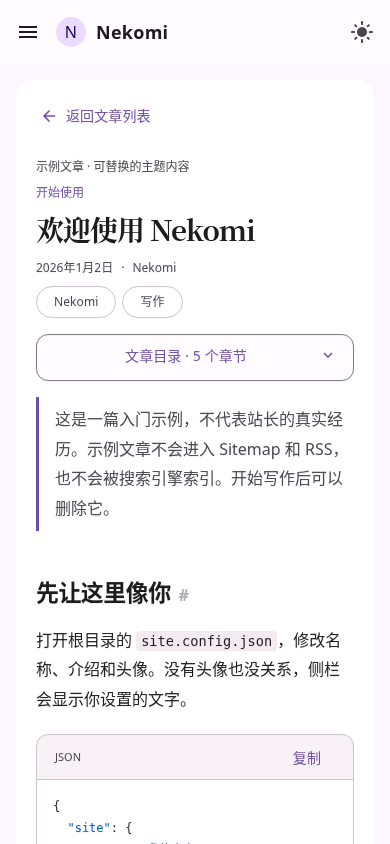

<h1 align="center">
  <br />
  Nekomi
</h1>

<p align="center">基于 Astro、MDUI 2 与 Material Design 3 的开源博客主题。<br />通过配置和 Markdown，搭建自己的静态博客。</p>

<p align="center">
  <a href="docs/CONFIGURATION-GUIDE.md">配置指南</a> ·
  <a href="#快速开始">快速开始</a> ·
  <a href="#文档">文档</a> ·
  <a href="LICENSE">MIT 许可证</a>
</p>

## 快速开始

推荐 **Node.js 24 LTS**，最低版本为 **22.23.4**，使用 npm 安装依赖。

```sh
git clone https://github.com/kylin930/Nekomi.git my-blog
cd my-blog
npm ci
npm run dev
```

打开 `http://localhost:4321`，接着[修改配置与编写文章](#配置与写作)。将项目推送到自己的仓库前，请先修改 Git 远程地址。

## 主题预览

<p align="center">
  
  
</p>

<p align="center">
  <a href="screenshots/p30-default-home-light-1440.png">桌面原图</a> ·
  <a href="screenshots/p30-default-reader-light-390.png">手机原图</a> ·
  <a href="screenshots/p30-default-home-dark-1440.png">深色模式</a>
</p>

## 主要特性

- **外观与个性化**：三种预设，自定义配色、字体、壁纸与装饰，适配深浅主题。
- **阅读与 Markdown**：代码高亮、目录、灯箱、公式与图表，适合长文阅读。
- **内容组织**：文章、独立页面、分类与标签，支持搜索、分页和自动加载。
- **导航与交互**：灵活的导航和侧栏，无刷新切换与壁纸保留，返回列表恢复位置。
- **评论与扩展**：按需接入评论、统计和自定义脚本，也支持自建评论适配器。
- **SEO 与部署**：分享信息、RSS 与站点地图，输出可直接托管的静态文件。

## 配置与写作

### 修改站点配置

编辑根目录的 `site.config.json`，只填写需要修改的选项，其余使用主题默认值：

```json
{
  "$schema": "./site.schema.json",
  "site": {
    "name": "我的博客",
    "tagline": "技术与日常"
  },
  "appearance": {
    "preset": "default"
  }
}
```

更换头像、主题色、壁纸、导航或页脚，请查看 **[简明配置指南](docs/CONFIGURATION-GUIDE.md)**。主题自带 Favicon 和 Apple 设备图标，可单独替换，与站点头像互不影响。

### 写第一篇文章

新建 `src/content/posts/hello.md`：

```md
---
title: 第一篇文章
date: '2026-10-28'
demo: false
---

## 从这里开始

在这里写 Markdown 正文。
```

保存后可访问 `/posts/hello/`。更多文章字段见 [文章信息参考](src/content/README.md)，扩展语法见 [Markdown 写作指南](docs/MARKDOWN.md)。

日常主要使用以下文件和目录：

```text
site.config.json       站点配置
src/content/posts/     文章
src/content/pages/     独立页面
src/assets/images/     可优化的图片
public/                按原路径发布的文件
```

模板中的示例内容默认不被索引；发布自己的文章前，请按[部署指南](docs/PUBLISHING.md)配置站点地址和索引设置。

## 文档

- **配置与外观**：**[配置指南](docs/CONFIGURATION-GUIDE.md)** · [完整参考](docs/CONFIGURATION.md) · [配置示例](examples/full.config.json) · [个性化](docs/PERSONALIZATION.md) · [图片](docs/IMAGES.md) · [装饰](docs/DECORATIONS.md) · [品牌资源](docs/BRANDING.md)
- **写作与页面**：[Markdown 写作](docs/MARKDOWN.md) · [文章信息](src/content/README.md) · [独立页面](docs/PAGES.md)
- **导航与扩展**：[侧栏](docs/SIDEBAR.md) · [导航](docs/CONFIGURATION.md#navigation) · [评论接入](docs/COMMENTS.md) · [自建适配器](docs/COMMENT-ADAPTERS.md) · [自定义脚本](docs/SCRIPTS.md)
- **发布与维护**：[部署指南](docs/PUBLISHING.md) · [升级指南](docs/UPDATING.md)

## 部署

构建并在本地预览：

```sh
npm run build
npm run preview
```

将生成的 `dist/` 部署到 GitHub Pages、Cloudflare Pages 或其他静态托管平台，生产环境不需要常驻 Node.js 服务。

[GitHub Pages](docs/PUBLISHING.md#github-pages) · [Cloudflare Pages](docs/PUBLISHING.md#cloudflare-pages) · [自定义域名与子路径](docs/PUBLISHING.md#先配置站点地址与内容性质)

## 许可证与贡献

Nekomi 主题代码采用 [MIT License](LICENSE)。第三方依赖、字体和素材遵循各自许可，详见[第三方声明](THIRD-PARTY-NOTICES.md)与[依赖许可清单](public/THIRD-PARTY-LICENSES.txt)。自行添加的图片、字体和其他资源需确认使用授权。

欢迎通过 [Issues](https://github.com/kylin930/Nekomi/issues) 反馈问题，或按[贡献指南](CONTRIBUTING.md)提交改进。[变更记录](CHANGELOG.md)包含版本更新说明。
