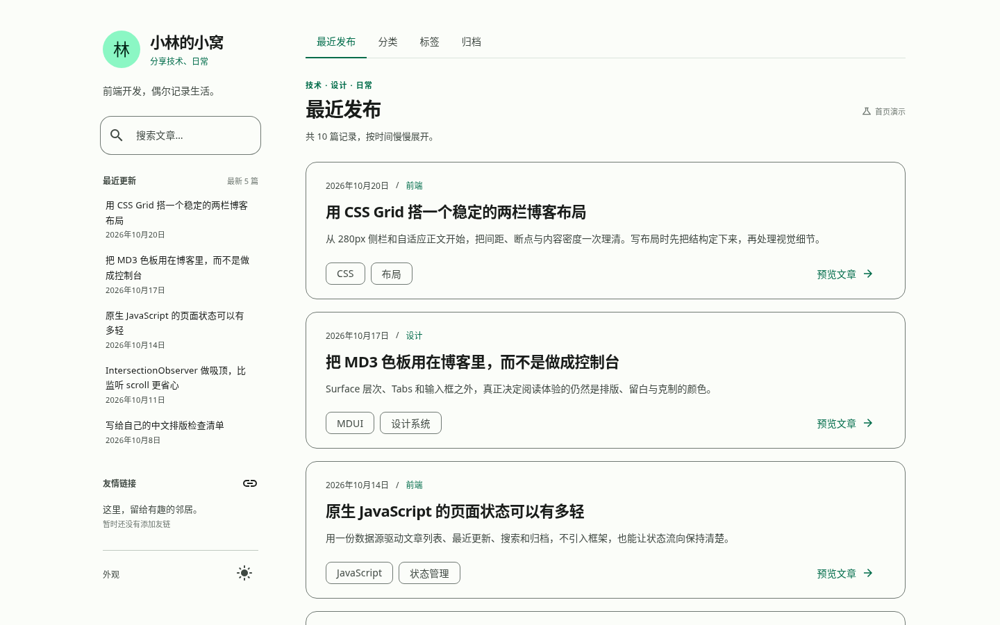

# 小林的小窝 · Nekopara Theme P0

参考 Stellar 的两栏信息架构、融合 G 的博客文章排版、使用 MDUI 2（Material Design 3）实现的原创静态博客主题首页。

本轮只实现 **P0 第三版首页**，不包含文章阅读页、评论、后台或静态生成器。

- 纯 HTML + CSS + 原生 JavaScript
- MDUI 2 通过 unpkg CDN 固定版本引入
- 桌面端整体式侧栏 + 内容区顶部切换栏
- 浅色 / 深色 / 跟随系统，带记忆
- 本地演示文章搜索、分类、标签、归档
- 移动端 Navigation Drawer

---

## 1. 预览

项目是纯静态站点，建议通过本地 HTTP 服务预览（MDUI 的 CDN 资源需要网络）：

```powershell
cd D:\Nekomi\nekomi-p0
python -m http.server 8080 --bind 127.0.0.1
```

然后打开：

```text
http://127.0.0.1:8080/
```

也可以使用任意静态服务器，例如：

```powershell
npx serve .
```

> 不依赖构建步骤。首次打开需要联网加载 MDUI 2 与 Material Icons 字体。

---

## 2. 目录结构

```text
nekomi-p0/
├─ index.html                     # 页面结构
├─ assets/
│  ├─ css/
│  │  ├─ tokens.css               # MD3 语义令牌、品牌主色、布局变量
│  │  └─ main.css                 # 侧栏、Tabs、文章卡片、响应式、抽屉、对话框
│  ├─ js/
│  │  ├─ data.js                  # 站点、文章、友链演示数据（唯一数据源）
│  │  ├─ theme.js                 # 浅色 / 深色 / 自动模式与菜单同步
│  │  └─ app.js                   # 渲染、Tabs、搜索、Hash、抽屉、预览对话框
│  └─ images/
│     └─ README.md                # 头像与封面图片的接入说明
├─ screenshots/                   # 实际浏览器截图
├─ README.md
├─ CHANGELOG.md
├─ THIRD-PARTY-NOTICES.md
└─ LICENSE
```

---

## 3. 布局与视觉

### 桌面端

| 参数 | 实际值 |
| --- | --- |
| 最大内容宽度 | `1200px` |
| 页面外边距 | `28px` |
| 左侧栏宽度 | `280px` |
| 两栏间距 | `28px` |
| 右侧内容区 | 自适应，1440px 视口下约 `836px` |
| 侧栏圆角 | `20px` |
| 卡片圆角 | `18px` |
| 封面圆角 | `12px` |

- 侧栏是**一个整体表面**（`surface-container-low` + 细边框），内部只用留白与分隔线组织，不是多张独立卡片。
- 侧栏内容顺序固定为：个人信息 → 搜索 → 最近更新（5 篇）→ 友情链接。
- 页面滚动时侧栏 `position: sticky`，并限制在 `100dvh` 内；内容超高时侧栏内部可滚动，最后一组内容不会被裁掉。
- 导航切换栏位于右侧主内容区顶部，不在侧栏。
- 主内容区使用统一的单列文章卡片；有 `cover` 时才渲染右侧紧凑封面，无封面时是完整纯文本布局，不出现空白图片框。

### 移动端（≤ 900px）

- 隐藏桌面侧栏，显示顶部工具栏：菜单按钮、站点名、主题按钮。
- 菜单打开 MDUI Navigation Drawer，抽屉复用同一份数据渲染个人信息、搜索、最近更新、友情链接。
- 内容区顶部继续保留 Tabs；空间不足时由 MDUI Tabs 内部横向滚动，页面本身不产生水平溢出。
- 文章卡片单列；封面按可用宽度自适应。
- 抽屉支持遮罩点击、关闭按钮、Escape 关闭，并处理焦点进入、焦点陷阱与关闭后的焦点恢复。

### 颜色与排版

- 页面背景：`surface`
- 卡片 / 侧栏：`surface-container-low`
- 主色：柔和的蓝紫色（在 MDUI 默认 MD3 令牌上覆盖 `primary` 系列）
- 文字：`on-surface` / `on-surface-variant`
- 边框：`outline-variant` 的柔和透明度
- 不使用渐变、玻璃模糊、插画背景、Hero 或装饰性英文标题。
- 动效只用于 hover / focus / 吸顶状态切换，并在 `prefers-reduced-motion: reduce` 下降级。

---

## 4. 数据配置

所有可编辑内容集中在 [`assets/js/data.js`](assets/js/data.js)。

### 站点信息

```js
site: {
  name: '小林的小窝',
  tagline: '分享技术、日常',
  intro: '前端开发，偶尔记录生活。',
  avatar: '',            // 留空 → 显示「林」字文字头像
  avatarAlt: '小林的小窝站点头像',
  avatarFallback: '林'
}
```

### 文章

```js
{
  id: 'css-grid-two-column-blog',
  title: '用 CSS Grid 搭一个稳定的两栏博客布局',
  excerpt: '……',
  date: '2026-10-20',
  category: '前端',
  tags: ['CSS', '布局'],
  cover: ''              // 留空 → 纯文本卡片；填入路径 → 紧凑图文卡片
}
```

- 文章列表、最近更新、搜索、分类、标签、归档全部来自这一份 `posts`。
- `cover` 为空或加载失败时会移除封面区域，自动回到纯文本布局。
- 日期、标题、摘要均明确为演示数据，见页头「演示数据」标记与页脚说明。

### 友链

```js
friends: [
  // { name, url, avatar, description }
]
```

- 默认留空，显示自然的空状态，不编造真实站点或站长资料。
- 有数据时最多渲染 5 个；`url` 仅接受 `http(s)` 链接。
- 「查看全部」目前是禁用状态，完整友链页面留待后续轮次。

### 头像与文章图片

本版**没有生成任何插画、AI 图片或默认动漫头像**。头像与封面字段已实现：

- 无头像 → 文字回退。
- 无封面 → 不占位、不渲染空图片框。
- 有封面 → 桌面端右侧 196px 图文布局；手机端单列自适应。
- 图片加载失败 → 自动回退为文字布局。

接入方式见 [`assets/images/README.md`](assets/images/README.md)。

---

## 5. 交互清单

| 交互 | 实现 |
| --- | --- |
| 顶部 Tab 切换 | MDUI 2 Tabs；点击、键盘方向键 / Home / End |
| URL Hash | `#recent` / `#categories` / `#tags` / `#archive`，支持前进后退 |
| 最近文章 | 与主列表共享文章数据，点击打开预览占位 |
| 本地搜索 | 标题、摘要、分类、标签过滤；输入即筛选 |
| 搜索快捷键 | `/` 聚焦搜索；`Escape` 清空；`Enter` 聚焦首个结果 |
| 搜索空结果 | 明确空状态与清除入口 |
| 标签筛选 | 点击任意标签回到「最近发布」并执行搜索 |
| 主题切换 | 浅色 / 深色 / 跟随系统；`localStorage` 记忆 |
| 移动端抽屉 | 打开、关闭按钮、遮罩、Escape、焦点陷阱、焦点恢复 |
| 预览占位 | 文章标题 / 最近更新 / 分类 / 归档条目打开 MDUI Dialog，明确说明阅读页未实现 |
| 吸顶 Tabs | 滚动到内容顶部后吸顶，带实色背景、边界和轻阴影 |
| 响应式 | 1440 / 1024 / 901 / 900 / 390 / 320px 已检查 |

> 还没有正式文章页面。点击标题不会跳到空链接，而是打开明确标注「P0 演示预览」的对话框；「查看全部」友链入口是禁用状态。

---

## 6. 实际截图

均由 Playwright + Chromium 实际打开本地页面生成（未压缩、未拼图）。

| 截图 | 文件 |
| --- | --- |
| 1440×900 桌面端浅色 | [desktop-light-1440x900.png](screenshots/desktop-light-1440x900.png) |
| 1440×900 桌面端深色 | [desktop-dark-1440x900.png](screenshots/desktop-dark-1440x900.png) |
| 390×844 手机端浅色 | [mobile-light-390x844.png](screenshots/mobile-light-390x844.png) |
| 390×844 手机端深色 | [mobile-dark-390x844.png](screenshots/mobile-dark-390x844.png) |
| 390×844 手机端抽屉展开 | [mobile-drawer-390x844.png](screenshots/mobile-drawer-390x844.png) |



---

## 7. 验证结果

本轮在 Chromium（Playwright 1.61.1）中实际打开页面检查不同视口，重点结果：

- MDUI 2 自定义元素正常加载，Tabs、Text Field、Dropdown、Menu、Dialog、Navigation Drawer 均可用。
- 1440×900、390×844、320×700 下无页面水平溢出。
- 1440×900 首屏可见顶部 Tabs、视图元信息与至少 3 篇文章主要内容；390×844 首屏可见 3 篇。
- Tabs 点击、键盘方向键、Home、End、URL Hash 与浏览器前进后退正常。
- 搜索过滤、清空、无结果状态、标签点击筛选、桌面与抽屉搜索框同步正常。
- 主题菜单三种模式、刷新后记忆、系统深色下 `auto` 模式正常。
- 抽屉打开 / 关闭、Escape、遮罩、关闭按钮、焦点陷阱、焦点恢复正常；打开时页面滚动被锁定。
- 侧栏在 600px 高度下内部可滚动，最后一组友情链接可完整访问。
- 无封面时卡片布局完整；注入封面时图文布局为 566 / 196px；图片加载失败会自动移除封面。
- 浏览器控制台无 JavaScript 报错，无失败资源（截图阶段）。

验证用的临时 Playwright 脚本依赖本机浏览器环境，未纳入源码；截图与上述检查结果是本轮交付依据。

---

### MDUI 2.1.5 组件审计与回归

已对照 [MDUI 2 官方文档](https://www.mdui.org/zh-cn/docs/2/)及固定版本源码核对组件 API：

- Drawer、Dialog 的焦点约束、Escape / 遮罩关闭与焦点恢复由组件负责；跨组件跳转等待 `closed`，移除固定动画延时。
- Tabs 的激活统一走组件 `click()` / `change`；2.1.5 未提供的键盘导航及 ARIA 继续补齐。面板保留在吸顶导航之外，保持原布局。
- 主题使用 `setTheme()`，Menu 使用 `value` property 同步，处理重复选择、跨页面存储更新及系统明暗变化；不再用内联 `color-scheme` 覆盖自动模式。
- 修复 2.1.5 Menu 异步焦点更新与 Dropdown 关闭的竞争：仅在焦点丢失或仍在隐藏菜单内时恢复到触发按钮。
- Text Field 直接消费内置清空操作的 `input` 事件；图标及清空按钮通过官方 slots 提供可读名称。
- Design Tokens 名称与 2.1.5 一致；Tabs 分隔线改用公开 CSS Part，避免改写子组件继承的颜色令牌。

可复现的浏览器回归见 [tests/README.md](tests/README.md)。本轮在 Chromium 中检查桌面、移动端、6 个宽度的明暗模式、主题记忆、键盘、搜索、URL 历史和模态交互；另检查短屏侧栏、减少动效及图片加载失败回退。

云环境中 Chromium 原生 CDN 请求遇到代理证书信任问题，因此本轮使用 `--verified-cdn`：由保持 TLS 验证的 curl 获取原始 CDN 响应后，在浏览器测试中回放。应用的 unpkg 地址、MDUI 版本和加载方式均未更改；未验证其他浏览器或此环境的 Chromium 原生 CDN 链路。

---

## 8. 已知问题 / P0 范围

1. **没有文章阅读页**：这是明确的 P0 限制。标题与最近更新打开的是预览 Dialog，不是阅读页。
2. **没有完整友链页面**：「查看全部」禁用；友链默认空状态。
3. **演示数据无真实图片**：按要求不生成头像 / 封面素材；图片字段与回退逻辑已实现。
4. **搜索只针对本地演示数据**：不连接远程服务，也没有分页。
5. **依赖 CDN**：MDUI 2 与 Material Icons 通过外部 CDN 加载，离线时组件和图标会降级。版本固定为 MDUI `2.1.5`。
6. **Tabs 键盘支持为补充实现**：MDUI 2.1.5 的 Tabs 没有内置方向键切换，本项目在语义化 `role="tab"` 结构上补充了 roving tabindex 与方向键 / Home / End 处理。
7. **浏览器范围**：面向现代常青浏览器（支持 Web Components、`dvh`、`aspect-ratio`、`overflow: clip`）。
8. **没有统计、公告、天气、项目卡片等额外侧栏小组件**：这是本轮约束，不是遗漏。

---

## 9. 第三方依赖与许可

运行时依赖只有：

- **MDUI 2.1.5** — MIT，unpkg CDN
- **Google Material Icons** — Apache-2.0，通过 Google Fonts 加载

本项目代码与视觉实现为原创；Stellar 与 G 仅作为布局 / 排版参考，没有复制其源码或图片资源。G 为 GPL-3.0，本项目不包含 G 的任何代码或素材。

详见 [THIRD-PARTY-NOTICES.md](THIRD-PARTY-NOTICES.md)。

本项目以 [MIT License](LICENSE) 发布。
