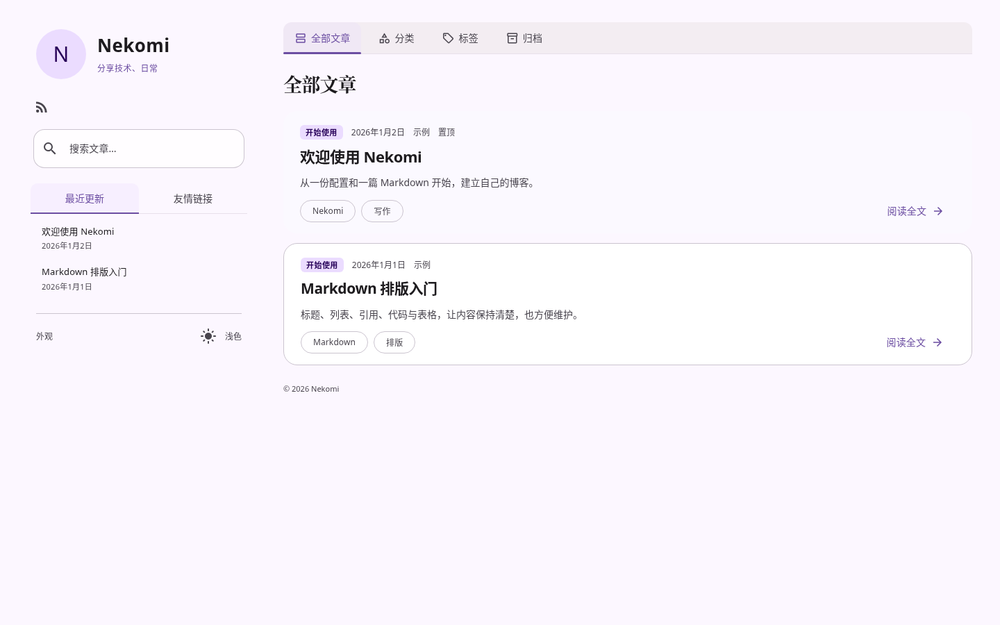
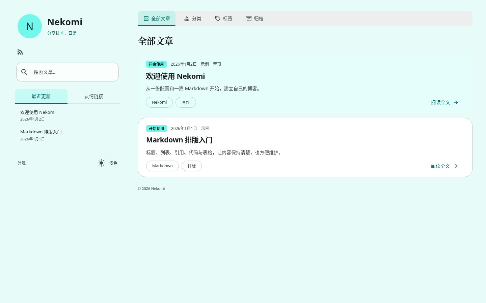
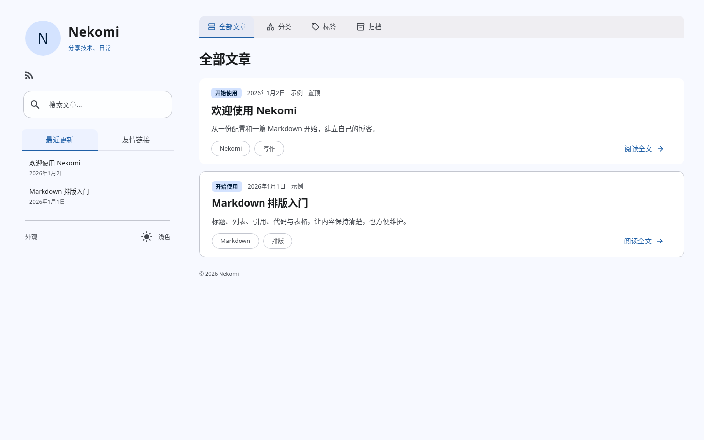
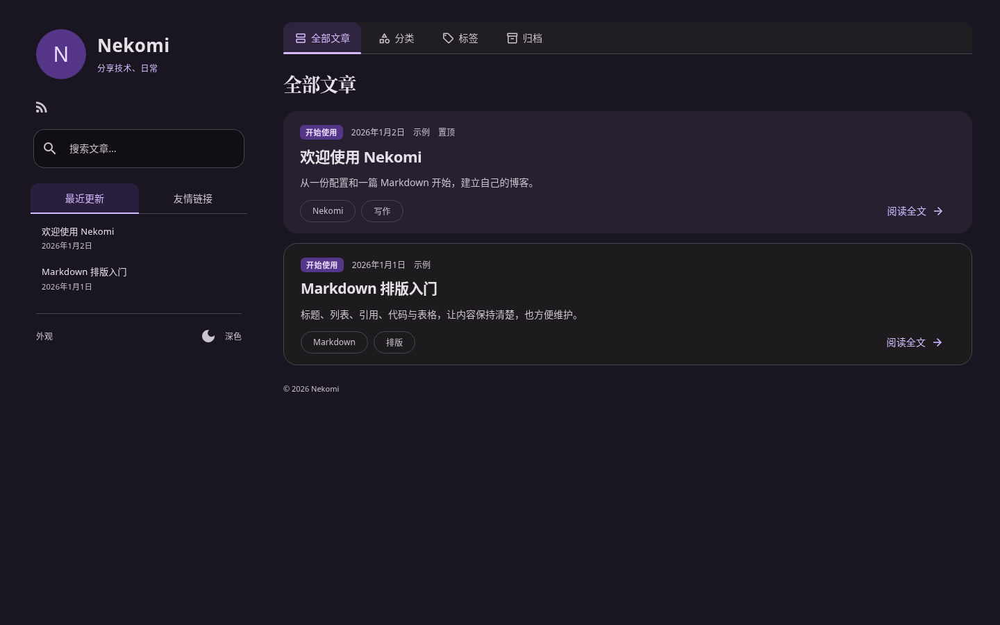
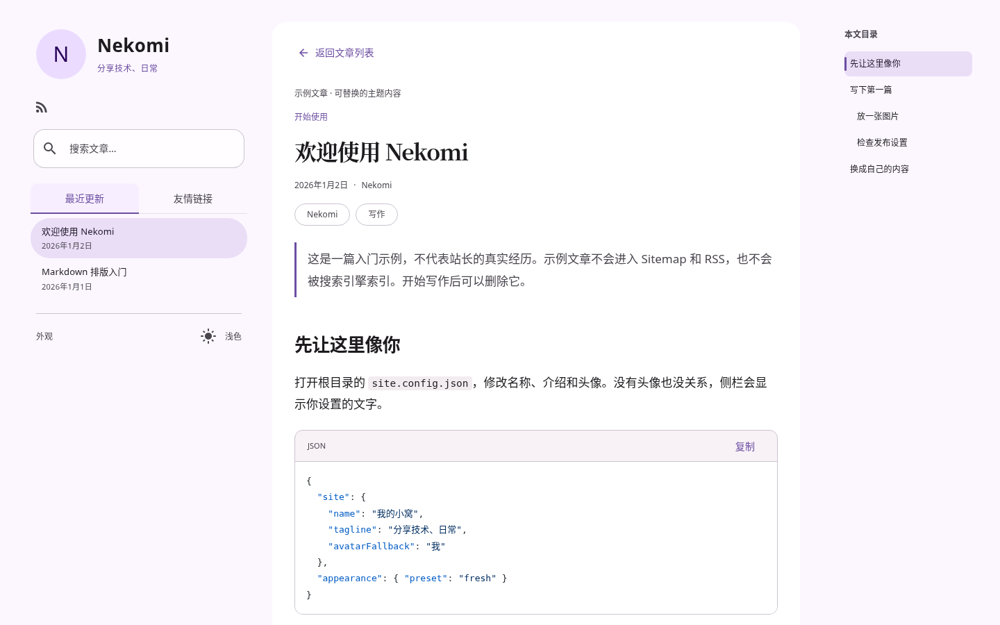

<h1 align="center"><br />Nekomi</h1>

<p align="center">基于 Astro、MDUI 2 与 Material Design 3 的开源静态博客主题。<br />用 JSON 配置外观，用 Markdown 写文章，构建后直接部署。</p>

<p align="center">
  <a href="https://astro.build"></a>
  <a href="https://www.mdui.org/"></a>
  <a href="https://m3.material.io/"></a>
  <a href="https://nodejs.org/">= 22.23.4" /></a>
  <a href="LICENSE"></a>
</p>

<p align="center">
  <a href="#快速开始">快速开始</a> ·
  <a href="#主题预览">主题预览</a> ·
  <a href="#文档">文档</a> ·
  <a href="docs/CONFIGURATION-GUIDE.md">配置指南</a> ·
  <a href="LICENSE">MIT 许可证</a>
</p>

## 目录

- [为什么选择 Nekomi](#为什么选择-nekomi)
- [主题预览](#主题预览)
- [主要特性](#主要特性)
- [快速开始](#快速开始)
- [配置与写作](#配置与写作)
- [常用命令](#常用命令)
- [项目结构](#项目结构)
- [文档](#文档)
- [部署](#部署)
- [常见问题](#常见问题)
- [参与贡献](#参与贡献)
- [许可证](#许可证)

## 为什么选择 Nekomi

Nekomi 面向想要「开箱可用、又能认真折腾」的静态博客：默认提供完整的 Material Design 3 外观、阅读增强和 SEO 输出，不需要数据库或常驻服务；个性化集中在 `site.config.json`，写作仍然只是 Markdown。

- **Material Design 3，而不是通用后台风**：使用 MDUI 2.1.5，主题自身基于 Astro 与原生 TypeScript / JavaScript，不引入 React、Vue 等前端框架。
- **三种预设，一套内容**：Default、Fresh、Minimal 可随时切换，也可以继续覆盖颜色、字体、圆角、壁纸与装饰。
- **静态优先**：构建产物是纯 HTML / CSS / JS，可部署到 GitHub Pages、Cloudflare Pages 或任意静态托管。
- **按需增强**：评论、统计、Mermaid、灯箱、视频等能力都按需加载，不启用时不阻塞正文阅读。

Nekomi 是静态博客主题，不包含后台、数据库、多用户投稿或可视化编辑器；评论需要接入独立的第三方服务或自建适配器。

技术栈：Astro 7 · MDUI 2.1.5 · TypeScript · Shiki · KaTeX · Mermaid · PhotoSwipe。

## 主题预览

以下截图来自项目的实际静态构建，示例内容仅用于展示主题能力。

<p align="center">
  <a href="screenshots/p30-default-home-light-1440.png"></a>
  <a href="screenshots/p30-fresh-home-light-1440.png"></a>
  <a href="screenshots/p30-minimal-home-light-1440.png"></a>
</p>

<p align="center"><sub>Default · Fresh · Minimal（浅色）</sub></p>

<p align="center">
  <a href="screenshots/p30-default-home-dark-1440.png"></a>
  <a href="screenshots/p30-default-reader-light-1440.png"></a>
</p>

<p align="center"><sub>深色首页 · 桌面阅读页</sub></p>

更多截图见[页面与主题截图](screenshots/pages.md)与[阅读与 Markdown 截图](screenshots/reading.md)，包括手机、分类、标签、归档、公式、Mermaid、提示块、Tabs 与灯箱。

## 主要特性

### 外观与个性化

- Default、Fresh、Minimal 三种预设，支持浅色、深色与跟随系统。
- 可配置主色、字体、圆角、壁纸、分类配色、侧栏与评论装饰。
- 站点名称、头像、Favicon、导航、页脚与社交链接均可替换。

### 阅读与 Markdown

- Shiki 双主题代码高亮、代码复制、文章目录、阅读时长、相关文章与上一篇 / 下一篇。
- PhotoSwipe 图片灯箱、KaTeX 公式、Mermaid 图表。
- 提示块、折叠内容、图片组、链接卡片、内容 Tabs、点击加载视频。
- 图片通过 Astro 优化为响应式资源；灯箱、图表等模块按需加载。

### 内容与检索

- 文章、独立页面、分类、标签、归档、置顶、草稿、封面与摘要。
- 站内搜索覆盖标题、摘要、分类与标签；静态分页并支持接近底部自动加载。
- 从文章返回列表时恢复筛选条件、已加载文章与滚动位置。

### 导航与交互

- Astro ClientRouter 无刷新切换、共享元素过渡，壁纸、侧栏与主题状态跨页保留。
- 侧栏可放最近更新、友情链接与最近评论，支持独立友链页。
- 返回顶部、移动端 Drawer；分页、内容 Tabs 与视频入口保留无脚本回退。

### 评论与扩展

- 内置 Giscus、Waline、Twikoo、Artalk 适配器；评论计数与最近评论取决于服务能力。
- 支持自建评论适配器、全站或按页面的自定义脚本，以及自托管 WebFonts。
- 评论与统计均为可选，不启用时不影响静态阅读。

### SEO 与部署

- Canonical、Open Graph、X Card、JSON-LD、RSS、Sitemap、robots 与索引开关。
- 示例内容与真实文章分开处理；未配置站点地址时不输出虚构的分享信息。
- 纯静态输出，支持根路径或子路径，生产环境不需要常驻 Node.js 服务。

## 快速开始

### 环境要求

| 项目 | 要求 |
| --- | --- |
| Node.js | `>= 22.23.4`，推荐 24 LTS |
| 包管理器 | npm（仓库包含 `package-lock.json`） |
| 运行环境 | 构建时需要 Node.js；部署后只需静态托管 |

### 获取主题

在 GitHub 上点击 **Use this template** 创建自己的仓库，然后克隆到本地；也可以直接克隆本项目：

```sh
git clone https://github.com/kylin930/Nekomi.git my-blog
cd my-blog
npm ci
npm run dev
```

打开 `http://localhost:4321`。`npm ci` 会严格按照锁文件安装依赖；修改过 `package.json` 后可改用 `npm install`。

首次使用建议先完成三件事：

1. 修改 `site.config.json` 中的站点名称、头像、导航和页脚。
2. 用自己的文章替换 `src/content/posts/` 中的示例文章。
3. 发布前按[部署指南](docs/PUBLISHING.md)配置站点地址、子路径和索引设置。

将项目推送到自己的仓库前，请先修改 Git 远程地址。

## 配置与写作

### 修改站点配置

编辑根目录的 `site.config.json`，只填写需要修改的选项，其余使用主题默认值：

```json
{
  "$schema": "./site.schema.json",
  "site": {
    "name": "我的博客",
    "tagline": "技术与日常"
  },
  "appearance": {
    "preset": "default"
  }
}
```

更换头像、主题色、壁纸、导航或页脚，请查看 **[简明配置指南](docs/CONFIGURATION-GUIDE.md)**。主题自带 Favicon 和 Apple 设备图标，可单独替换，与站点头像互不影响。

### 写第一篇文章

新建 `src/content/posts/hello.md`：

```md
---
title: 第一篇文章
date: '2026-10-28'
description: 一句话摘要，会出现在列表和分享信息中。
category: 随笔
tags: [Markdown, Astro]
demo: false
---

## 从这里开始

在这里写 Markdown 正文。
```

保存后可访问 `/posts/hello/`。更多文章字段见[文章信息参考](src/content/README.md)，扩展语法见[Markdown 写作指南](docs/MARKDOWN.md)。

### 文章 Frontmatter

| 字段 | 必填 | 说明 |
| --- | --- | --- |
| `title` | 是 | 文章标题 |
| `date` | 是 | 发布日期，格式为 `YYYY-MM-DD` |
| `description` / `excerpt` | 否 | 列表与分享信息使用的摘要 |
| `category` | 否 | 分类名称 |
| `tags` | 否 | 标签数组 |
| `cover` | 否 | 封面图片路径 |
| `pinned` | 否 | 是否置顶 |
| `draft` | 否 | 是否为草稿 |
| `comments` | 否 | 是否启用评论，默认 `true` |
| `demo` | 否 | 是否标记为演示内容 |

同一目录支持子文件夹，子目录名会成为文章 URL 的一部分。

### 日常使用的文件和目录

```text
site.config.json       站点配置
src/content/posts/     文章
src/content/pages/     独立页面
src/assets/images/     可优化的图片
public/                按原路径发布的文件
```

模板中的示例内容默认不被索引；发布自己的文章前，请按[部署指南](docs/PUBLISHING.md)配置站点地址和索引设置。

## 常用命令

| 命令 | 作用 |
| --- | --- |
| `npm ci` | 按锁文件安装依赖 |
| `npm run dev` | 启动开发服务器，默认 `http://localhost:4321` |
| `npm run build` | 构建静态站点到 `dist/` |
| `npm run preview` | 本地预览构建产物 |
| `npm run check` | 运行 Astro / TypeScript 检查 |
| `npm run test:config` | 运行配置 Schema 测试 |
| `npm run config:docs` | 由 Schema 同步配置文档与示例 |
| `npm run licenses` | 生成依赖许可清单，构建前自动执行 |

## 项目结构

```text
.
├── site.config.json          # 站点配置（日常主要编辑）
├── site.schema.json          # 配置 JSON Schema
├── src/
│   ├── content/
│   │   ├── posts/            # 文章
│   │   └── pages/            # 独立页面
│   ├── assets/images/        # 参与 Astro 图片优化的资源
│   ├── components/           # 布局与组件
│   ├── config/               # 主题默认值、Schema 与构建配置
│   ├── integrations/         # 评论、脚本构建集成
│   ├── layouts/              # 页面布局
│   ├── plugins/              # Markdown 扩展
│   └── styles/               # 设计令牌与样式
├── public/                   # 按原路径发布的静态文件
├── docs/                     # 使用文档
├── examples/                 # 可复制的配置示例
├── scripts/                  # 配置文档与许可生成脚本
└── tests/                    # 测试与回归
```

只想写作时，通常只需要关注 `site.config.json` 与 `src/content/`。

## 文档

普通写作与配置只需要“开始使用”和“配置与外观”两组；开发文档面向主题贡献者。

| 分类 | 文档 |
| --- | --- |
| 开始使用 | [配置指南](docs/CONFIGURATION-GUIDE.md) · [完整参考](docs/CONFIGURATION.md) · [完整示例](examples/full.config.json) · [升级指南](docs/UPDATING.md) |
| 配置与外观 | [个性化](docs/PERSONALIZATION.md) · [图片](docs/IMAGES.md) · [装饰](docs/DECORATIONS.md) · [品牌资源](docs/BRANDING.md) · [侧栏](docs/SIDEBAR.md) |
| 写作与页面 | [Markdown 写作](docs/MARKDOWN.md) · [文章信息](src/content/README.md) · [独立页面](docs/PAGES.md) |
| 评论与扩展 | [评论接入](docs/COMMENTS.md) · [自建适配器](docs/COMMENT-ADAPTERS.md) · [自定义脚本](docs/SCRIPTS.md) |
| 发布与维护 | [部署指南](docs/PUBLISHING.md) · [变更记录](CHANGELOG.md) · [历史配置](docs/HISTORY.md) |
| 截图 | [页面与主题](screenshots/pages.md) · [阅读与 Markdown](screenshots/reading.md) · [预设与配置](screenshots/presets.md) · [评论](screenshots/comments.md) · [动效](screenshots/motion.md) · [浏览与位置恢复](screenshots/browsing.md) |
| 开发文档 | [贡献指南](CONTRIBUTING.md) · [动效约定](docs/MOTION.md) · [个性化实现](docs/PERSONALIZATION-AUDIT.md) · [测试说明](tests/README.md) · [依赖与许可](docs/DEPENDENCIES.md) |

## 部署

构建并在本地预览：

```sh
npm run build
npm run preview
```

将生成的 `dist/` 部署到静态托管平台即可。生产环境不需要常驻 Node.js 服务。

| 平台 | 说明 |
| --- | --- |
| [GitHub Pages](docs/PUBLISHING.md#github-pages) | 仓库提供手动 Pages 工作流；在仓库变量中设置 `SITE_URL` 与 `SITE_BASE` |
| [Cloudflare Pages](docs/PUBLISHING.md#cloudflare-pages) | 构建命令 `npm run build`，输出目录 `dist`，Node.js 版本选择 24 |
| 其他静态托管 | 上传 `dist/`；部署在子路径时务必设置 `SITE_BASE` |

`SITE_URL` / `SITE_BASE` 环境变量优先于 `site.config.json` 中的地址与路径。子路径示例：

```sh
SITE_URL=https://username.github.io SITE_BASE=/Nekomi/ npm run build
```

不要把 `/Nekomi/` 同时写进 `SITE_URL`。自定义域名、Canonical 与 Sitemap 设置的完整说明见[部署指南](docs/PUBLISHING.md)。

## 常见问题

### 构建时提示 Node.js 版本过低？

需要 Node.js `>= 22.23.4`，推荐 24 LTS。用 `node -v` 检查版本，升级后重新执行 `npm ci`。

### 部署到子路径后样式或图片 404？

设置 `SITE_BASE=/你的仓库名/`，例如 `/Nekomi/`；`SITE_URL` 只填源站地址，然后重新构建。不要手动把子路径写进 `SITE_URL`。

### 文章没有被搜索引擎收录？

检查 `publishing.indexing` 是否为 `true`、文章 `demo` 是否为 `false`，并正确配置 `publishing.url` 与 `publishing.base`。RSS 与 Sitemap 使用同一套发布规则。

### 评论没有显示？

评论需要独立部署的服务。检查 `comments.provider`、服务地址、允许域名，以及服务端的 CORS 与 iframe 策略；不同适配器支持的计数、最近评论和定位能力不同。

### 如何升级主题？

保留自己的 `site.config.json`、`src/content/` 与自定义资源，按[升级指南](docs/UPDATING.md)合并上游改动，再运行 `npm run check` 与 `npm run build` 验证。

## 参与贡献

欢迎通过 [Issues](https://github.com/kylin930/Nekomi/issues) 反馈问题，或按[贡献指南](CONTRIBUTING.md)提交改进。提交前请运行：

```sh
npm run check
npm run build
```

UI 改动请附上截图；新增配置或行为时，请同步更新文档与回归测试。

## 许可证

Nekomi 主题代码采用 [MIT License](LICENSE)。第三方依赖、字体和素材遵循各自许可，详见[第三方声明](THIRD-PARTY-NOTICES.md)与[依赖许可清单](public/THIRD-PARTY-LICENSES.txt)。自行添加的图片、字体和其他资源需确认使用授权。

<p align="center"><sub>如果 Nekomi 对你有帮助，欢迎 Star 支持项目。</sub></p>
