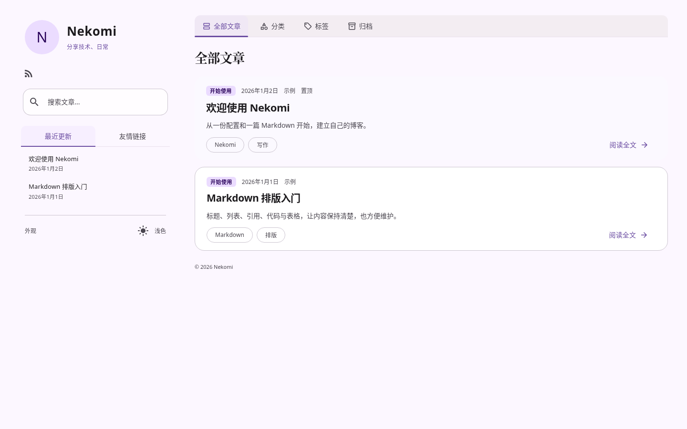

# Nekomi

**代码版本：1.0.0** · [中文发布说明](docs/releases/v1.0.0.md)

一个基于 **Astro 静态生成、MDUI 2.1.5 与 Material Design 3** 的原创个人博客主题。融入页面的 Stellar 式侧栏、日系个人站气质、舒适的中文排版；配置和 Markdown 就是日常使用入口，不需要 React、Vue 或常驻 Node.js 服务。

**文档导航：** [快速开始](#开始使用) · **[配置说明](docs/CONFIGURATION.md)** · [写作指南](docs/MARKDOWN.md) · [评论接入](docs/COMMENTS.md) · [部署指南](docs/PUBLISHING.md)

第一次配置站点？先看 **[简明配置指南](docs/CONFIGURATION-GUIDE.md)**：修改名称、头像、配色、壁纸、侧栏和页脚，或接入评论。[完整配置示例](examples/full.config.json)与 [JSON Schema](site.schema.json) 供复制查阅和编辑器补全。

主题自带正式 SVG Favicon 和 Apple 设备图标，无需配置；`site.favicon`、`site.appleTouchIcon` 可覆盖，留空恢复内置图标，与 `site.avatar` 独立。[图标配置](docs/CONFIGURATION-GUIDE.md#浏览器与设备图标) · [品牌资源与 GitHub Social Preview](docs/BRANDING.md)



[手机阅读](screenshots/p30-default-reader-light-390.png) · [深色模式](screenshots/p30-default-home-dark-1440.png) · [Fresh 预设](screenshots/p30-fresh-home-light-1440.png) · [Minimal 预设](screenshots/p30-minimal-home-light-1440.png) · [P3 实际截图](screenshots/P30.md)

- 独立 Markdown 页面与可选首页内容 Tabs、侧栏模块可拆为常驻区；支持有清理生命周期的自定义 JS，默认不加载。
- 可复用 Astro 组件与 Content Collections；Markdown、Shiki 双主题高亮、本地响应式图片、原生 MDUI 目录与代码复制。
- 构建时 KaTeX 与阅读时间、按需 Mermaid / 图片灯箱、原生 MDUI 内容 Tabs；提示、折叠、图片组、链接卡片和点击加载视频，直接写在 `.md` 中。
- ClientRouter 无刷新导航、标题 / 封面共享过渡、轻量弹簧目录；尊重减少动态效果。
- 可选全站原生 MDUI 返回顶部 FAB，滚动超过 400px 显示；支持键盘、减少动态及浮层避让，`layout.backToTop` 默认开启。
- 壁纸可选、默认关闭。启用后跨页面保留相同 DOM 与已解码图片，Service Worker 缓存仅辅助刷新。
- 静态分页 + 可选无限滚动，全量文章搜索，分类 / 标签 / 月份独立 URL；返回列表恢复条件、批次和位置。
- 可配置预设、侧栏模块 / Tabs、导航、卡片、阅读、页脚；Zod 校验、类型与编辑器 JSON Schema 同源。
- 可选侧栏 / 评论区角色装饰（默认关闭，自备素材）、站点图标和移动端独立壁纸，空间不足自动退让。
- 可选 Waline / Twikoo / Giscus / Artalk，统一 TypeScript 评论接口，支持自建适配器；默认关闭第三方服务。
- Canonical、Open Graph、X Card、JSON-LD、官方 Sitemap / RSS、Robots；示例内容默认不被索引。

## 开始使用

推荐 **Node.js 24 LTS**，最低 `22.23.4`；使用 npm 与仓库锁文件。需要 HTTP(S) 预览，不支持直接打开 `file://`。

在 GitHub 使用 **Use this template → Create a new repository**（维护者需先在仓库 Settings 勾选 Template repository）；也可以克隆后修改自己的 Git remote：

```sh
git clone https://github.com/kylin930/Nekomi.git my-blog
cd my-blog
npm ci
npm run dev
```

访问 `http://localhost:4321`。日常只需编辑：

```text
site.config.json         你的站点配置
src/content/posts/*.md   你的文章
src/assets/images/       可优化头像、封面、正文图片
public/                  按原路径发布的文件，例如壁纸
```

不要修改主题内部的 `src/config/schema.mjs` 来配置站点。默认值由主题维护，用户配置只写需要覆盖的部分。配置修改后重新构建；开发服务器未反映配置时重启。

## 配置你的站点

从 [简明配置指南](docs/CONFIGURATION-GUIDE.md) 按需求复制示例；查找某个字段的类型、默认值或范围，直接打开 [完整配置参考](docs/CONFIGURATION.md)。

```json
{
  "$schema": "./site.schema.json",
  "site": {
    "name": "我的小窝",
    "tagline": "分享技术、日常",
    "intro": "技术笔记与日常文章。",
    "avatarFallback": "我",
    "social": [{ "name": "GitHub", "url": "https://github.com/你的用户名", "icon": "github" }]
  },
  "appearance": { "preset": "fresh", "color": "#427f79" }
}
```

**Default** 保留 Nekomi 紫色与原有形状；**Fresh** 使用柔和青绿与辅助色；**Minimal** 降低首篇染色、收敛形状并采用简洁标题字体。三者共享同一套 Token 与页面结构。显式 `color`、`secondary`、`font`、`headingFont`、`brandFont`、`radius` 优先于预设。字体不自动从外部下载，使用你设备上的字体栈。

[完整配置参考：类型、默认值、范围与依赖](docs/CONFIGURATION.md) · [完整配置示例](examples/full.config.json) · [Fresh](examples/fresh.config.json) · [最小配置](examples/minimal.config.json)

数组按给出的顺序整体替换。`layout.modules` 可选 profile/social/search/tabs；`layout.sidebarTabs` 可选 updates/friends/comments。评论关闭或内置服务不支持最新查询时隐藏评论 Tab；可查询但尚无留言时显示空状态。普通用户不用设置每个间距；栏宽与页面宽度有安全范围，保留既有响应式结构。

品牌字体使用独立的 `appearance.brandFont`，默认是本地无衬线字体栈，不下载新字体；文章标题仍由 `headingFont` 控制。首页标题区只显示标题；旧 `home.eyebrow` 继续接受但不显示，`home.description` 用作全部文章页的 SEO 描述。

升级时，已有的 `site.intro`、`footer.text` 等显式配置仍会保留；想采用新的简洁默认值，可清空或删除这些字段。

`site.social[].icon` 可省略或设为 `auto`，会识别 GitHub、Bilibili 与邮箱，其他链接显示网站图标；也可显式选择 `github`、`bilibili` 或 MDUI 图标名。品牌图标来自本地 CC0 Simple Icons。RSS 由 `features.rss` 控制，在侧栏 `social` 模块及手机 Drawer 显示，默认页脚只保留动态版权文字；`footer.text`、`footer.copyright`、`footer.links` 仍可自定义。

例如添加自己的平台链接（地址需替换）：

```json
{
  "site": {
    "social": [
      {
        "name": "GitHub",
        "url": "https://github.com/your-name",
        "icon": "github"
      },
      {
        "name": "Bilibili",
        "url": "https://space.bilibili.com/你的UID",
        "icon": "bilibili"
      }
    ],
    "email": "hello@example.com"
  },
  "appearance": {
    "brandFont": "system-ui, \"PingFang SC\", sans-serif"
  }
}
```

## 通用主题个性化

分类配色不再依赖特定名字。使用 `content.categoryColors` 选择 MD3 角色或 HEX，`content.defaultCategory` 修改默认分类名称，`content.categoryPreviewLimit / archivePreviewLimit` 控制首页预览。常用文案与侧栏 Tab 名称可通过分组 `ui` 覆盖；日期遵循 `publishing.language / timeZone`，其中 language 不会自动翻译整站。

普通顶部入口使用 `navigation.topLinks`，与内容 Tabs 分开；自托管字体通过可选 `appearance.webFonts` 定义并在现有字体栈中引用。默认没有新增字体请求。

[使用说明](docs/PERSONALIZATION.md) · [中文个人站示例](examples/personalized.config.json) · [英文通用站示例](examples/journal.config.json) · [审计记录与保留常量](docs/PERSONALIZATION-AUDIT.md)

## 可选角色装饰

侧栏和评论区可通过 `appearance.decorations.sidebar / comments` 配置角色图片；默认关闭，无素材时保持原布局。`site.favicon / appleTouchIcon` 设置站点图标，`appearance.wallpaper.mobileLight / mobileDark` 设置窄屏壁纸，`layout.recentPostsLimit / friendsPreviewLimit` 控制侧栏预览数量。[使用说明及安全布局](docs/DECORATIONS.md) · [可复制配置](examples/decorations.config.json)。图片请放入 `public/` 或使用有权使用的 HTTPS 资源。

## 独立页面与扩展

[独立 Markdown 页面](docs/PAGES.md) · [侧栏常驻模块](docs/SIDEBAR.md) · [自定义 JS 生命周期](docs/SCRIPTS.md) · [组合示例配置](examples/site-features.config.json)。示例使用仓库已有的关于 / 项目页：关于进入首页真实 Tab，项目保留独立链接；友链常驻于 Tabs 下方。示例 JS 默认关闭，HTTPS WOFF2 仅在显式使用该示例配置时加载，根配置保持原首页和旧侧栏。

## 写第一篇文章

在 `src/content/posts/hello.md` 写入：

````md
---
title: 你好，世界
date: '2026-10-24'
category: 随笔
tags: [生活]
excerpt: 第一篇文章的简短介绍。
demo: false
---

## 从这里开始

正文使用 Markdown。

```js
console.log('Hello, Nekomi');
```
````

文章地址为 `/posts/hello/`，请尽量保持文件名稳定。日期按 `YYYY-MM-DD` 填写；`updated` 只在确实更新时填写。摘要不填时从正文生成，默认最多 140 字。可选字段还包括 `author`、`description`（SEO）、`pinned`、`draft`、`cover`、`coverAlt`、`comments`、`commentId`、`commentPath`、`commentsUrl` 、`readingTime`、`markdown` 和单篇 `reading` 开关。

[Frontmatter 参考](src/content/README.md)。`draft: true` 不生成文章页，也不进入搜索 / 订阅。`pinned: true` 在列表中优先展示；RSS 始终按日期。默认保留三篇入门 / 扩展示例文章，正文和 `demo: true` 字段说明其示例性质；文章顶部不再显示示例标签。`demo` 仍控制 SEO、RSS 和 Sitemap 排除，不要为了调整页面显示而改成 `false`。可以删除不需要的示例，空站仍可构建。

## Markdown 扩展与阅读

[完整写作语法](docs/MARKDOWN.md)提供可复制的提示块、折叠、图片组、链接卡片、视频、内容 Tabs、数学公式与 Mermaid 示例。[完整示例文章](src/content/posts/markdown-extensions.md)可直接在本地打开 `/posts/markdown-extensions/`；[实际桌面 / 手机截图](screenshots/P31.md)。

正文未链接图片支持灯箱、键盘与触控；带链接图片仍打开原链接。KaTeX 在构建时渲染，Mermaid 只在实际需要时加载并跟随主题。外部视频初始不创建播放器，需要读者点击。相关文章按分类 / 共同标签在构建时计算，不依赖外部推荐服务。

```json
{
  "reading": { "lightbox": true, "readingTime": true, "related": true, "relatedLimit": 3 },
  "markdown": { "math": true, "mermaid": true, "components": true },
  "friendsPage": { "enabled": true, "navigation": false }
}
```

以上均有默认值，无需整段复制。单篇 `readingTime: false` 隐藏时长，`readingTime: 5` 指定分钟数；`reading` 和 `markdown` 对象可覆盖单篇功能。友链复用 `friends` 配置，默认 `/friends/` 已生成，侧栏“查看全部”进入该页；开启 `friendsPage.navigation` 可额外在公共侧栏显示入口。关闭页面开关仍兼容旧 Dialog。

## 头像、封面和壁纸

- 头像 / 封面放入 `src/assets/images/`，配置 `site.avatar: "images/avatar.webp"`，文章写 `cover: images/cover.webp` 和 `coverAlt`。Astro 生成响应式 WebP 和固有尺寸；无头像使用文字回退，失效封面收起。
- Markdown 可使用 `` 对应 src/assets/images/photo.webp，也支持相对文件路径；public 图片使用 `/images/photo.webp`。图片必须自行提供并确认授权。
- `cards.cover` 可选 `auto`（宽屏右图、窄屏上图）、`top`、`none`；`reading.cover` 控制阅读页头图。
- **壁纸默认关闭**。将有权使用的图片放在 `public/images/wallpaper.webp` 后配置：

```json
{
  "appearance": {
    "wallpaper": {
      "enabled": true,
      "light": "images/wallpaper.webp",
      "dark": "",
      "lightOverlay": 0.60,
      "darkOverlay": 0.68,
      "position": "center",
      "fit": "cover"
    }
  }
}
```

壁纸也支持运行时 HTTP(S) 地址；它不参与 Astro 构建期图片优化，随机 API 不会被构建固定成某张图。浅深遮罩、卡片 / 阅读表面和缓存时长分别可调。新模板不请求原站个人图片 API。[图片详细说明](docs/IMAGES.md)

## 发布、SEO 与订阅

确认真实站点地址后，在配置里设置：

```json
{
  "demo": false,
  "publishing": {
    "url": "https://blog.example.com",
    "base": "/",
    "indexing": true,
    "author": "你的署名"
  }
}
```

地址仅为示例，不是主题默认正式域名。`url` 是源站，`base` 是路径；也可用 `SITE_URL`、`SITE_BASE` 构建环境变量覆盖。`SITE_URL` 不应包含 `/Nekomi/`。

全站 `demo:false` + `indexing:true` + 真实地址才启用索引。每篇 `demo:true` 仍然 noindex、排除 RSS 和 Sitemap；不要把主题样例当作自己的真实文章发布。无封面且无分享图时不生成虚构图片。分类、标签、月份和分页直接输出真实链接，无 JS 仍可发现文章。

RSS 为 `/rss.xml`，Robots 为 `/robots.txt`，可收录内容生成 `/sitemap-index.xml`。相关开关见 `features`。部署在项目子路径时需在域名根目录合并 robots 规则；详见 [发布说明](docs/PUBLISHING.md)。

```sh
npm run check
npm run test:config
npm run build
npm run preview
```

部署 `dist/` 的静态文件，不需要生产 Node 服务或 SPA fallback；服务器应正常解析目录 `index.html`，不存在路径返回 `404.html` 与 HTTP 404。

### GitHub Pages

1. 创建自己的仓库。Settings → Pages → Source 选择 GitHub Actions。
2. 仓库 Actions Variables 添加 `SITE_URL=https://你的用户名.github.io`、`SITE_BASE=/你的仓库名/`；用户主页仓库或自定义根域使用 `/`。
3. 本仓库提供[手动 Pages 工作流](.github/workflows/pages.yml)，在 Actions 手动运行。它会检查、构建并部署静态产物，不在克隆后自动发布。
4. 自定义域名按 GitHub Pages 文档设置 DNS / HTTPS，并在 `public/CNAME` 写你的域名；同步改 `SITE_URL` / `SITE_BASE`，不要使用原作者域名。

### Cloudflare Pages

连接自己的 Git 仓库；构建命令 `npm run build`，输出目录 `dist`，Node 版本设为 24。环境变量 `SITE_URL` 填实际自定义域名（或项目 Pages 地址），`SITE_BASE=/`。需要根域时在平台设置 Custom domains / DNS，并重新构建更新 Canonical。不要为静态路由添加全站重写到首页的规则。

## 从 P2.4 迁移与保留个人配置

原“小林的小窝”配置完整保存在 [`examples/personal/site.config.json`](examples/personal/site.config.json)，十篇原示例及稳定锚点保存在 [`examples/demo-posts/`](examples/demo-posts/)。以下命令仅切换构建输入，不覆盖文件：

```sh
npm run dev:personal
npm run build:personal
```

若要继续作为原站开发，可将这份配置与原示例复制回自己的配置 / 内容目录，并移除新入门示例；先备份已经写的真实内容。原配置中的壁纸 API 属于原站个人选择，其他用户默认不会访问。所有旧内容仍保留 demo 保护。

以后更新时，建议把自己的配置和 Markdown 单独提交，先建备份分支并审阅 CHANGELOG。克隆 / Fork 且保留上游历史的仓库可合并 upstream 更新；GitHub Template 创建的仓库具有独立历史，推荐在新目录引入新版主题，保留自己的 site.config.json、文章、src/custom 自有适配器、src/assets 图片及 public 内自用资源，再按迁移说明验证。不要直接用旧 public 目录覆盖新版主题 Worker。也支持将个人数据放在主题目录之外：

```sh
NEKOMI_CONFIG=/path/to/my-site.json NEKOMI_CONTENT_DIR=/path/to/posts npm run build
```

独立配置继承主题默认值，不继承仓库根的个人设置。图片仍放在本项目 `src/assets/` 或 `public/`。升级后运行检查，未知 / 删除字段会给出具体配置路径，避免静默失效。[贡献与架构说明](CONTRIBUTING.md)

## 动态评论与自建扩展

评论默认关闭，可选 **Waline、Twikoo、Giscus、Artalk**，浏览器连接独立服务，静态博客不增加 Node 后端。每个服务的能力如实声明：Waline / Twikoo / Artalk 支持公开计数和最近查询；Giscus 只有已挂载讨论的计数消息，不提供全站最近评论 API，因此隐藏该侧栏页签。

```json
{
  "comments": {
    "provider": "waline",
    "waline": { "serverURL": "https://comments.example.com" }
  }
}
```

这里是占位地址，需要先部署自己的服务。[四种服务的最小配置、部署入口、能力边界与迁移](docs/COMMENTS.md) · [配置示例](examples/comments/) · [真实客户端截图](screenshots/P25-COMMENTS.md)

文章可以设置 `comments: false`、稳定 `commentId` 或原服务 `commentPath`。线程键默认不带域名或部署 base，更改标题不会换线程；重命名文件时保留 commentId。最新评论从选用服务动态获取，按键匹配当前文章，草稿 / 关闭评论 / 未知文章被过滤；不手工维护正常运行的评论列表，也不伪造评论定位。

自建服务通过 `comments.provider: "custom"` 与项目内模块接入。[CommentAdapter 开发说明](docs/COMMENT-ADAPTERS.md)提供完整 TypeScript 生命周期、能力声明、取消 / 清理要求，以及[可运行的只读 REST 范例](examples/comments/rest-adapter.ts)。用户模块放在 src/custom，无需修改主题核心。全部前端配置公开，不能放 API 私钥或管理凭据；认证、审核、反垃圾由独立服务负责。

早期 link / commentsUrl 方式保留；comments.items 仅兼容明确标识的 demo:true 预览，不再作为正常站点的最新评论来源。

## 统计与许可

统计默认关闭。目前可选 Umami，需显式提供脚本地址和公开 website ID；不接受私钥。默认没有评论 SDK 或统计请求；显式启用后才连接所选服务。图标字体仍由 Google Fonts 提供，属于字体资源请求；需完全离线时可按第三方许可自行托管字体。

主题代码为 [MIT](LICENSE)；[第三方依赖与素材说明](THIRD-PARTY-NOTICES.md)。Stellar、G 与 Cuckoo 仅用于设计参考，没有复制 GPL 源码或受保护的主题素材。历史阶段截图可能包含原站自行提供的背景，不属于主题许可或默认资产。P2.5 新截图使用无背景默认值，或项目自身界面截图作为测试图片。

[测试结果](tests/RESULTS.md) · [动效与 MDUI 分工](docs/MOTION.md) · [配置参考](docs/CONFIGURATION.md) · [CHANGELOG](CHANGELOG.md)
