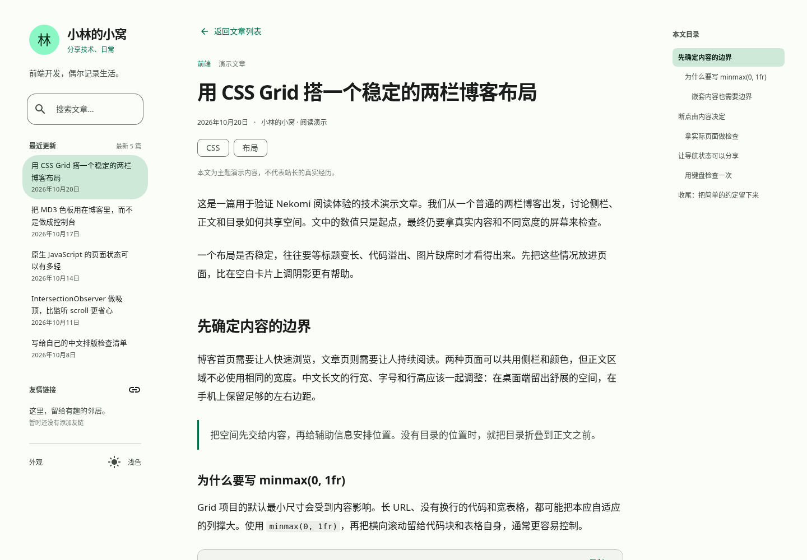

# Nekomi · 小林的小窝

基于 **MDUI 2.1.5 / Material Design 3** 的原创静态博客主题。参考 Stellar 的融入式侧栏、内容导航与辅助目录，以及 G 的文章信息层次和阅读节奏；所有页面代码独立实现。

P0 首页与 P1 阅读页已打通。继续使用 HTML、CSS、原生 JavaScript，不绑定博客框架，没有构建步骤。全部文章、日期与叙事均为演示，不代表站长的真实经历。



[桌面深色阅读](screenshots/article-desktop-dark-1440x1000.png) · [手机浅色阅读](screenshots/article-mobile-light-390x844.png) · [手机深色阅读](screenshots/article-mobile-dark-390x844.png) · [技术正文](screenshots/article-code-desktop-1440x1000.png) · [手机表格](screenshots/article-table-mobile-390x844.png) · [普通长文](screenshots/article-essay-desktop-1440x1000.png) · [无效文章](screenshots/article-not-found-390x844.png)

[首页桌面浅色](screenshots/desktop-light-1440x900.png) · [首页桌面深色](screenshots/desktop-dark-1440x900.png) · [首页手机浅色](screenshots/mobile-light-390x844.png) · [首页手机深色](screenshots/mobile-dark-390x844.png) · [手机抽屉](screenshots/mobile-drawer-390x844.png) · [分类](screenshots/desktop-categories-1440x900.png) · [手机搜索](screenshots/mobile-search-390x844.png)

## 本地开发

在仓库根目录启动任意静态 HTTP 服务：

```sh
python3 -m http.server 8080 --bind 127.0.0.1
```

访问本地 8080 端口。阅读演示地址：

- 技术长文：`article.html?post=css-grid-two-column-blog`
- 虚构随笔：`article.html?post=weekend-walk-by-river`
- 章节深链接：`article.html?post=css-grid-two-column-blog#grid-minimum`

需要 HTTP 服务，不能直接以 `file://` 打开。运行时需能访问 `unpkg.com`、`fonts.googleapis.com` 与 `fonts.gstatic.com`。MDUI CSS / JS 均固定为 **2.1.5**，继续通过 unpkg 引入。

## 页面与原生组件

- **公共外壳**：`site.js` 为两个入口生成同一套侧栏、移动 App Bar、Navigation Drawer、页尾和反馈 Snackbar；侧栏无整体背景、边框、圆角与阴影，超高时独立滚动。
- **首页**：保留现有 Tabs / Tab Panel、outlined Card、Chip、List / List Item。分类、标签、归档和最近更新由同一份元数据推导；标题、封面、按钮和原生列表项均使用真实文章链接。
- **阅读页**：标题、日期、分类、标签、可选头图；正文提供多级标题、段落、引用、列表、图片、分割线、表格与代码排版。桌面正文上限 760px，手机保持单列。
- **目录**：按 h2–h6 自动生成嵌套列表，支持当前章节、标题永久链接与焦点定位。1360px 起放在右侧，较窄屏幕使用原生 Collapse；不挤占正文空间。
- **技术内容**：代码块显示语言，原生 Button 复制原始文本，Snackbar 反馈；长代码和宽表格在自身区域横向滚动，支持键盘访问。
- **移动端**：860px 及以下使用原生 Top App Bar 和模态 Navigation Drawer；App Bar 在文档流中占位并吸顶，组件负责抽屉焦点约束、滚动锁定、Escape / 遮罩关闭。
- **主题**：图标按钮依次切换“浅色 → 深色 → 跟随系统”，同时显示当前模式与下次动作；`setColorScheme('#476756')` 生成语义色，`setTheme()` 管理主题，偏好跨页面保存。没有主题下拉菜单。
- **过渡**：页面内容与首页 Tab 面板使用短暂的非线性滑入，正常文档链接保留分享、新标签页和浏览器历史；减少动态效果偏好下禁用自定义过渡。

CSS 主要负责布局与文章排版，组件调整使用官方公开 CSS Parts / 变量。没有复制 G 的 PHP、CSS、JavaScript 或素材，也没有添加其他 UI 框架或美术资源。许可与参考范围见 [THIRD-PARTY-NOTICES.md](THIRD-PARTY-NOTICES.md)。

## 数据与正文

编辑 [`assets/js/data.js`](assets/js/data.js) 配置站点、文章元数据与友链：

```js
{
  id: 'example-post',
  title: '文章标题',
  excerpt: '用于首页和搜索的摘要。',
  date: '2026-10-20',
  category: '前端',
  tags: ['CSS'],
  content: 'content/posts/example-post.html',
  cover: '',
  coverAlt: ''
}
```

正文存放在 [`content/posts/`](content/posts/)，不重复页头与 h1。两篇主要样本分别展示技术长文与普通随笔，其余八篇也有独立正文。详细约定及生成器迁移边界见 [content/README.md](content/README.md)。

- 没有封面时不创建空图片位；首页宽卡片右图、窄卡片上图，阅读页头图独立显示。
- 坏封面收起，坏正文图保留替代文字提示，头像失败回退文字。
- 默认不添加封面或虚构友链。友链格式为 `name`、`url`、`avatar`、`description`，显示最多 5 个。
- 搜索标题、摘要、分类与标签，不搜索正文；首页 `?q=关键词#recent` 可独立分享。文章页搜索输入后按 Enter 返回首页结果。
- 无效文章 ID 显示友好提示与返回入口；正文载入失败可重试。静态演示错误界面仍是 HTTP 200，正式发布时应由生成器或服务器提供真正的 404。

封面示例：[桌面右图](screenshots/cover-layout-desktop-1440x900.png) · [手机上图](screenshots/cover-layout-mobile-390x844.png)。测试临时使用本项目界面截图，默认数据保持无封面。图片接入见 [assets/images/README.md](assets/images/README.md)。

## 键盘与历史

- 首页 Tabs 支持方向键 / Home / End，状态与 Hash 同步；搜索参数可刷新恢复。
- `/` 聚焦搜索；手机上打开抽屉并通过原生 `autofocus` 聚焦。输入框内的 `/` 正常输入。
- 首页搜索支持空结果、原生清空、可删除关键词 Chip；桌面 Escape 清空，手机 Escape 关闭抽屉；Enter 进入首个结果焦点或空结果标题。
- 文章目录使用真实片段链接，点击后聚焦目标标题；直接打开、刷新、前进后退均能恢复章节。上一篇 / 下一篇和返回列表使用原生链接。
- 提供跳过导航、可见焦点、可访问名称、存储不可用回退与减少动效支持。

MDUI 2.1.5 尚未提供完整的 Tabs 键盘 / ARIA 与图标按钮 ARIA 转发。[`a11y.js`](assets/js/a11y.js) 只补齐固定版本缺失能力，不重做面板管理、组件视觉或模态焦点机制。

## 验证

```sh
python3 tests/browser_audit.py --chromium /usr/bin/chromium --artifacts /tmp/nekomi-browser
```

覆盖 P0 与 P1 的浏览器回归，详见 [tests/README.md](tests/README.md)。截图由实际 Chromium 页面生成，包含桌面与手机明暗模式。

当前云环境使用 `--verified-cdn`：curl 保持代理与 TLS 校验，取得原始 CDN 响应后在 Chromium 中回放。它不更改应用的 CDN 地址、资源或浏览器信任库，不关闭证书验证；测试验证页面行为，不代表 Chromium 原生 CDN 证书链已配置。Firefox / Safari 尚未实测。

本轮止于 P1：未开发评论、后台、分页、服务端搜索或静态生成器。正文载入与公共组件增强依赖 JavaScript；生产环境的静态正文、SEO 与路由输出留给未来选定的生成器。

## 文件

```text
index.html                首页 Tabs 与索引容器
article.html              阅读页语义结构
assets/css/tokens.css     共用布局尺度与减少动效令牌
assets/css/main.css       公共布局、首页和公开 CSS Parts
assets/css/article.css    阅读排版与目录响应式布局
assets/js/data.js         文章元数据索引
assets/js/site.js         公共外壳、真实路由与搜索入口
assets/js/a11y.js         固定 MDUI 版本的必要无障碍补充
assets/js/theme.js        MD3 色板与三态主题按钮
assets/js/app.js          首页渲染、筛选与 URL 状态
assets/js/article.js      正文载入、目录、锚点与复制
content/posts/            独立、可信的演示正文片段
screenshots/              实际浏览器截图
tests/                    P0 / P1 浏览器回归
```

本项目采用 [MIT License](LICENSE)。
