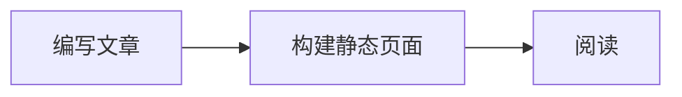
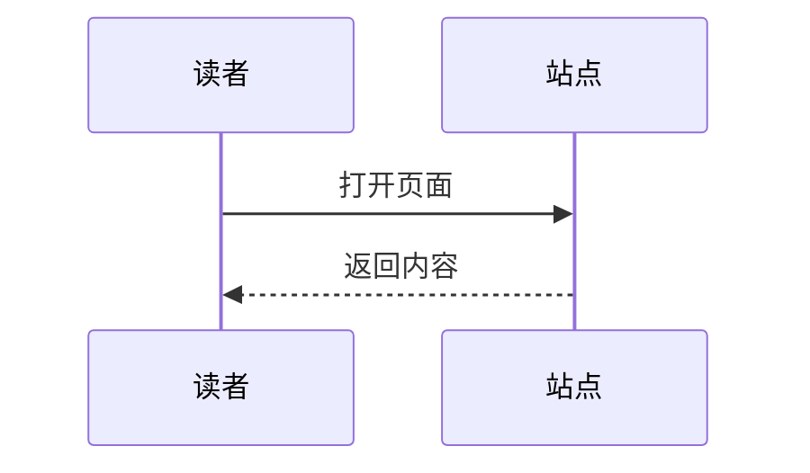

# Markdown 写作与内容组件

文章使用普通 `.md`，不需要 MDX。完整可运行样例见 [markdown-extensions.md](../src/content/posts/markdown-extensions.md)，基础语法见 [markdown-guide.md](../src/content/posts/markdown-guide.md)。两者均标记 `demo: true`，不会进入 RSS 或 Sitemap。

## 开关与加载

以下是默认值，未填写时自动启用：

```json
{
  "markdown": { "math": true, "mermaid": true, "components": true },
  "reading": {
    "lightbox": true,
    "readingTime": true,
    "related": true,
    "relatedLimit": 3
  },
  "friendsPage": { "enabled": true, "navigation": false }
}
```

单篇文章可在 Frontmatter 覆盖：

```yaml
markdown:
  math: false
  mermaid: false
  components: false
reading:
  lightbox: false
  related: false
readingTime: 8
```

`readingTime: false` 隐藏时长，`true` 使用自动估计，正整数直接指定分钟数（1–10000）。该字段优先于文章 / 全站 `reading.readingTime`；`reading.metadata: false` 隐藏整组元信息。

公式在构建阶段渲染，仅含公式的文章输出 KaTeX 样式与字体引用。Mermaid 只在含图表的文章加载控制模块，接近图表时下载引擎。灯箱库与样式在首次点击可用正文图片时下载。指令交互仅用于具有 Tabs 或视频的文章；纯提示、折叠和链接卡片不需要新增客户端控制模块。关闭扩展后保留可读正文、公式文本和图表源码。

## 正文图片与灯箱

```md


[](https://example.com/)
```

`images/photo.webp` 对应 `src/assets/images/photo.webp`，Astro 生成响应式图片与固有尺寸，灯箱打开原始资产；src/ 之外的相对内容图片通过 Astro 输出全分辨率同格式资产。`/images/photo.webp` 对应 `public/images/photo.webp`。也支持相对于文章文件的本地路径和外部 HTTP(S) 图片。请自行提供有权使用的图片。

未套链接的正文图片支持点击或 Enter / Space 打开：方向键切换、Esc 关闭、缩放按钮 / 滚轮、放大后拖动；触控支持滑动切图、双指缩放及拖动。说明优先使用 figure 的 figcaption，再取图片 title 或 alt；“查看原图”使用普通安全链接。关闭后焦点返回原图。带链接的图片保留原有导航，不被接管；加载失败的图片显示原有回退，不加入灯箱。外链图片无已知原图尺寸时使用已加载图片尺寸，不会额外探测远程原图。

## 提示块

```md
:::note[提示]
可以写 **Markdown**、列表和 `代码`。
:::

:::info[说明]{icon="info--outlined"}
图标可选，使用 MDUI Material 图标名。
:::

:::success[操作完成]
配置已保存。
:::

:::warning[操作前确认]
请备份原配置。
:::

:::danger[权限提醒]
不要将服务端密钥放入静态配置。
:::
```

`tip` 是 `note` 的别名。标题可以省略，使用各类型默认标题。图标、颜色使用 MDUI / MD3 语义角色，不以颜色单独传达含义。

## 折叠内容

````md
::::details[补充说明]
这里支持段落、列表和代码。

:::note[内部提示]
内层比外层少一个冒号。
:::

```sh
npm run check
```
::::

:::details[默认展开]{open}
不需要 JavaScript 也可展开、收起。
:::
````

使用原生 `<details>` / `<summary>`，支持键盘。目录跳到折叠内容中的标题时会先展开，再定位和聚焦。

## 图片组

```md
:::gallery[图片组说明]


:::
```

宽屏两列，手机单列；每张保留说明并参与正文灯箱。组内仅支持图片（也可套链接）、图片引用；不要放普通段落或视频。图片链接依旧跳转，不进入灯箱。

## 链接卡片

```md
::link[Astro 文档]{href="https://docs.astro.build/zh-cn/" description="静态页面与内容集合的官方说明。"}

::link[站内文章]{href="/posts/welcome/" description="从这里开始。"}
```

使用真实链接，关闭 JavaScript 仍可访问。不自动抓取目标页面标题、封面或 Open Graph，不产生隐形第三方请求。描述为纯文本；站内路径自动适配部署 base。

## 点击加载视频

```md
::video[YouTube 视频]{provider="youtube" id="M7lc1UVf-VE"}

::video[Bilibili 视频]{provider="bilibili" id="BV1GJ411x7h7"}
```

替换为你要引用的视频 ID。YouTube 接受 11 位视频 ID；Bilibili 接受 BV 号。页面初始不创建 iframe、不下载播放器、不抓取缩略图。读者点击“加载视频”才连接平台，可再次点击关闭。YouTube 使用 youtube-nocookie 域名，Bilibili 使用官方 player.bilibili.com；关闭 JS 时保留平台原链接。

iframe 受固定来源、sandbox 和最小权限限制，不开启自动播放。点击后平台仍可能处理 IP、Cookie 等信息；无 Cookie 域名不代表完全匿名。广告、登录、地区限制和视频是否可嵌入由平台决定，失败时可用原链接打开。不要在指令中放任意 iframe URL / HTML。

## 内容 Tabs

`````md
::::tabs[选择安装工具]
:::tab[npm]

```sh
npm install
```

:::
:::tab[pnpm]

```sh
pnpm install
```

:::
::::
`````

使用 MDUI 原生 Tabs / Tab / Tab Panel，保留方向键、焦点和状态层。每个 `tabs` 直接子元素必须是 `tab`，至少一项；内容支持普通 Markdown 和其他指令。目录 / URL Hash 跳入非活动面板中的标题时会先切换面板。关闭 JS 时所有面板依次可读，正文不复制、不产生重复锚点。

容器嵌套时外层冒号更多，闭合冒号数与开头一致；指令最多嵌套 8 层，Tabs 最多嵌套 2 层。过深、拼错名称、未知属性或错误 URL 会在构建时报告文章和位置，请修正后发布。指令标题 / 属性仅为纯文本，复杂 Markdown 放在容器正文中。

## 数学公式

```md
行内公式 $E = mc^2$。

$$
\int_0^1 x^2\,dx = \frac{1}{3}
$$
```

KaTeX 在构建时输出 HTML + MathML，客户端不再次解析。块级公式可横向滚动，浅深模式继承正文颜色。信任模式关闭，不支持公式内注入 HTML / 任意外部资源；错误公式保留可识别的源码提示。需要显示字面量 `$` 时转义为 `\$`。

## Mermaid

````md



````

可在 Mermaid 源码中使用 `accTitle: 图表标题` / `accDescr: 图表说明` 补充无障碍信息。图表容器保留可聚焦滚动区域，SVG 的语义不会被外层图片角色覆盖。

支持 Mermaid 常见图表，跟随当前 MD3 配色和明暗模式重新渲染。图表区域可横向 / 纵向滚动，宽图不会撑开正文。折叠内容及 Tabs 内图表在实际可见后渲染。源码可展开、复制；渲染失败时自动显示源码及重试，不阻塞文章。

保持 strict 安全模式、禁用 HTML labels 和图表 bindFunctions。为保证主题一致性和安全，不接受 `%%{init: ...}%%` 或 Mermaid YAML 内嵌配置；单图最多 20000 字符、200 条边。只对可信作者内容构建，不能把此主题作为不可信用户提交的 Markdown 渲染服务。

## 阅读时间与相关文章

预计阅读时间在构建时按每分钟约 400 个中日韩字符 + 220 个英文单词计算，向上取整、至少 1 分钟。不将代码块、行内代码、公式、HTML、图片地址及 Markdown 标记当正文统计；是阅读长度提示，不跟踪读者行为。

相关文章优先同分类且有共同标签，再同分类、最后仅共同标签；组内按共同标签数量、发布日期、ID 排序。不填无关条目，排除当前文章、草稿；示例文章与正式文章分组，避免把示例推荐到真实文章。`reading.relatedLimit` 可设 0–6（默认 3），`reading.related: false` 全关，单篇可覆盖。与上一篇 / 下一篇分别提供关联和时间顺序导航。

## 友情链接页

`friendsPage.enabled: true` 默认生成 `/friends/`，复用 `friends` 数据和头像回退；有友链时侧栏“查看全部”进入该页。`friendsPage.navigation: true` 在公共侧栏底部显示入口（含 Drawer），没有友链时页面显示“暂无友链”。关闭页面生成时恢复原有“查看全部” Dialog。友情链接页遵循全站索引开关，无友链时 noindex。

## 安全与兼容边界

指令链接只接受 HTTP(S)、mailto、站内路径和锚点；拒绝脚本 / data / 协议相对地址、账号密码 URL 等。外部页面使用 noopener noreferrer。指令文本由 AST 输出，不插入任意原始 HTML。但主题继续支持标准 Markdown 原始 HTML，故文章作者必须受信任。第三方视频需读者主动加载；Mermaid / PhotoSwipe 均本地打包，不依赖新增 CDN。

兼容 ClientRouter：离开页面会取消控制器、观察器、媒体实例和图片查看器，正在完成的旧图表任务不会写入新页面；不更换公共侧栏、壁纸或主题 DOM。减少动态效果设置同时约束灯箱和原有阅读动效。
