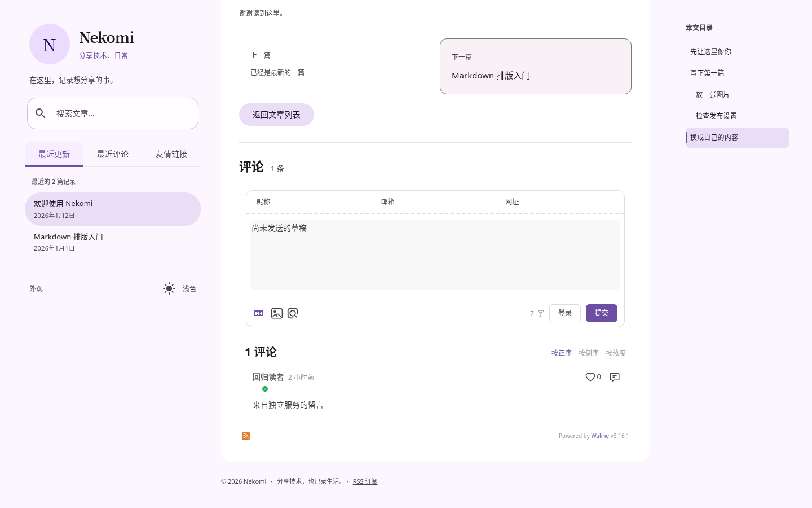
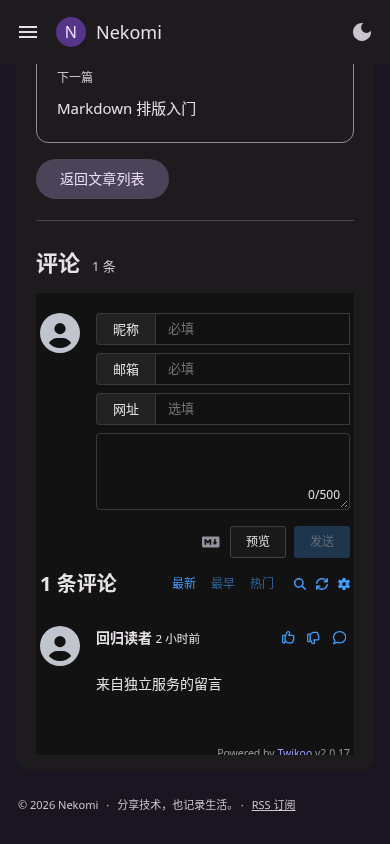
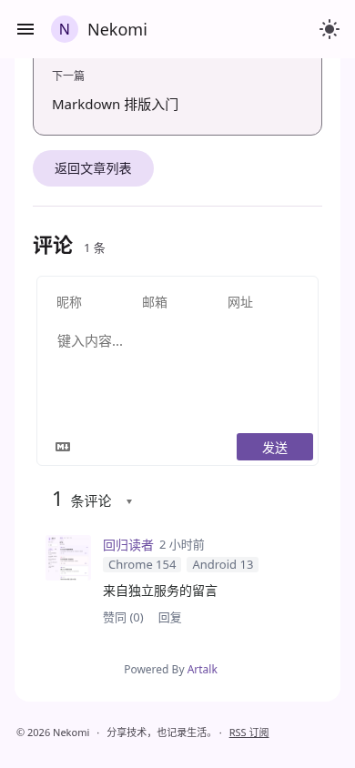

# P2.5 动态评论：实际浏览器截图

2026-10-24；Chromium 154、生产静态产物。桌面 1440×900，手机为触控 / Android 移动上下文 390×844。通用默认配置没有外部壁纸，截图保留现有页面宽度、圆形头像、融入式侧栏、MDUI 原生目录与主题。

截图中的留言为明确的自动化回放数据，并非站长真实评论。Waline / Twikoo / Artalk 执行固定版本的真实 SDK 和 CSS（含 SRI），只替换服务 API 响应（头像回放使用项目自身截图）；Giscus 执行真实官方 client.js，远程讨论 UI / 消息对端由测试模拟，不能作为真实 GitHub OAuth 验证。Custom 执行仓库内的只读 REST 适配器示例。

| 适配器 | 桌面浅色 | 桌面深色 | 手机浅色 | 手机深色 |
| --- | --- | --- | --- | --- |
| Waline 3.16.1 | [查看](p25-comments-waline-desktop-light.png) | [查看](p25-comments-waline-desktop-dark.png) | [查看](p25-comments-waline-mobile-light.png) | [查看](p25-comments-waline-mobile-dark.png) |
| Twikoo 2.0.17 | [查看](p25-comments-twikoo-desktop-light.png) | [查看](p25-comments-twikoo-desktop-dark.png) | [查看](p25-comments-twikoo-mobile-light.png) | [查看](p25-comments-twikoo-mobile-dark.png) |
| Giscus 消息协议 | [查看](p25-comments-giscus-desktop-light.png) | [查看](p25-comments-giscus-desktop-dark.png) | [查看](p25-comments-giscus-mobile-light.png) | [查看](p25-comments-giscus-mobile-dark.png) |
| Artalk 2.10.0 | [查看](p25-comments-artalk-desktop-light.png) | [查看](p25-comments-artalk-desktop-dark.png) | [查看](p25-comments-artalk-mobile-light.png) | [查看](p25-comments-artalk-mobile-dark.png) |
| 自定义 REST | [查看](p25-comments-custom-desktop-light.png) | [查看](p25-comments-custom-desktop-dark.png) | [查看](p25-comments-custom-mobile-light.png) | [查看](p25-comments-custom-mobile-dark.png) |

## Waline：桌面浅色

## Twikoo：手机深色

## Artalk：手机浅色

默认 / Fresh / Minimal、自定义个人配置、首页与阅读页的原图集见 [P25](P25.md)。测试范围与限制见 [测试记录](../tests/RESULTS.md)，真实服务接入见 [评论文档](../docs/COMMENTS.md)。
