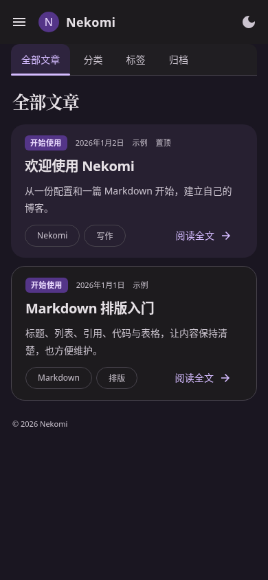
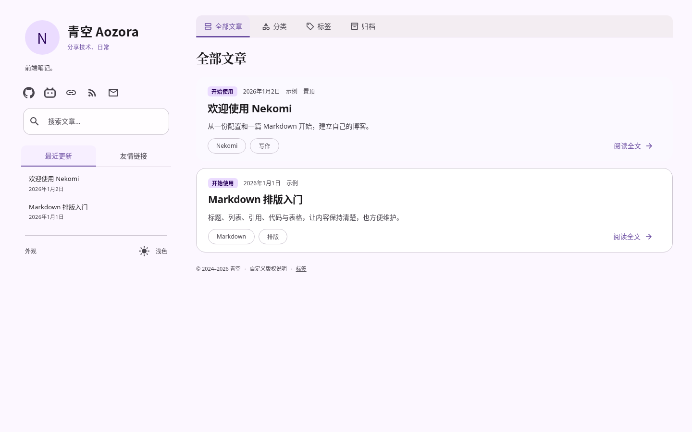
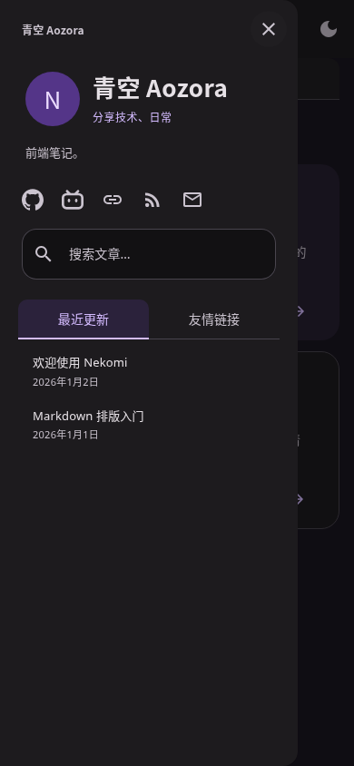

# P3.0 实际截图

2026-10-24，生产静态构建，Chromium 154。桌面 1440×900，手机 390×844，手机使用触控上下文。默认无壁纸，既有布局 / 卡片 / 色板保留；没有新增插画或外部字体。截图中的 Fresh / Minimal 仅切换预设便于比较，完整预设示例配置另外由原配置矩阵检查。

| 配置 | 桌面浅色 | 桌面深色 | 手机浅色 | 手机深色 |
| --- | --- | --- | --- | --- |
| Default | [查看](p30-default-home-light-1440.png) | [查看](p30-default-home-dark-1440.png) | [查看](p30-default-home-light-390.png) | [查看](p30-default-home-dark-390.png) |
| Fresh | [查看](p30-fresh-home-light-1440.png) | [查看](p30-fresh-home-dark-1440.png) | [查看](p30-fresh-home-light-390.png) | [查看](p30-fresh-home-dark-390.png) |
| Minimal | [查看](p30-minimal-home-light-1440.png) | [查看](p30-minimal-home-dark-1440.png) | [查看](p30-minimal-home-light-390.png) | [查看](p30-minimal-home-dark-390.png) |
| 中英文品牌 / 社交 / 页脚自定义 | [查看](p30-custom-home-light-1440.png) | [查看](p30-custom-home-dark-1440.png) | [查看](p30-custom-home-light-390.png) | [查看](p30-custom-home-dark-390.png) |
| 无社交 / RSS / 搜索 | [查看](p30-quiet-home-light-1440.png) | [查看](p30-quiet-home-dark-1440.png) | [查看](p30-quiet-home-light-390.png) | [查看](p30-quiet-home-dark-390.png) |

## 默认首页

## 手机首页

## 自定义品牌与图标

GitHub / Bilibili 链接使用平台首页，仅用于配置验证，不是站长账号；邮箱和网站使用保留示例地址。SVG 为 CC0 Simple Icons。配置只修改 brandFont、站点信息、社交链接和页脚，没有复制页面样式。

## 四个主 Tab 与阅读页

| 页面 | 浅色 | 深色 |
| --- | --- | --- |
| 分类 | [查看](p30-default-categories-light-1440.png) | [查看](p30-default-categories-dark-1440.png) |
| 标签 | [查看](p30-default-tags-light-1440.png) | [查看](p30-default-tags-dark-1440.png) |
| 归档 | [查看](p30-default-archive-light-1440.png) | [查看](p30-default-archive-dark-1440.png) |
| 桌面阅读 | [查看](p30-default-reader-light-1440.png) | [查看](p30-default-reader-dark-1440.png) |
| 手机阅读 | [查看](p30-default-reader-light-390.png) | [查看](p30-default-reader-dark-390.png) |
| 默认手机 RSS 入口 | [查看](p30-default-drawer-light-390.png) | [查看](p30-default-drawer-dark-390.png) |

分类 / 标签卡片上的数量保留用于浏览选择，标题区域没有装饰说明或重复统计。默认页脚仅为动态版权；自定义配置图保留用户指定的版权、文字与链接。搜索计数、失败和重试仍按交互显示。

[配置说明](../docs/CONFIGURATION.md) · [完整测试记录](../tests/RESULTS.md)
