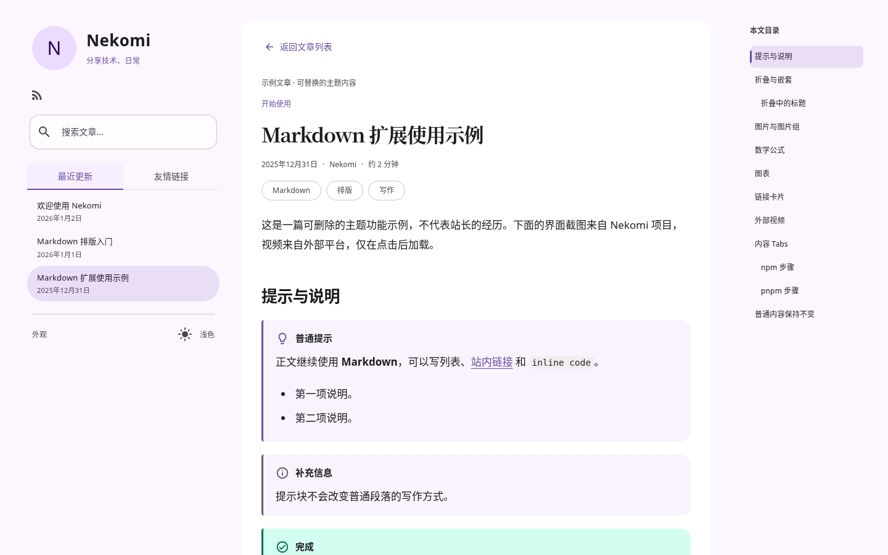
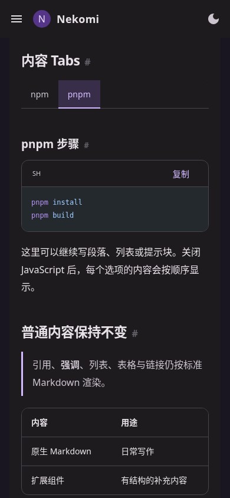

# P3.1 文章阅读与 Markdown 截图

Astro 生产静态产物，由 Python HTTP 服务器提供；Chromium 154 实际截图。桌面 1440×900、触控手机 390×844，均含浅色 / 深色。正文截图使用仓库三篇默认示例，无壁纸、无新美术素材；灯箱中的图片是项目原有界面截图，不是新的默认站点设计。

| 内容 | 桌面浅色 | 桌面深色 | 手机浅色 | 手机深色 |
| --- | --- | --- | --- | --- |
| 文章首屏 / 预计时长 | [查看](p31-reader-light-1440.png) | [查看](p31-reader-dark-1440.png) | [查看](p31-reader-light-390.png) | [查看](p31-reader-dark-390.png) |
| MD3 提示块 | [查看](p31-callouts-light-1440.png) | [查看](p31-callouts-dark-1440.png) | [查看](p31-callouts-light-390.png) | [查看](p31-callouts-dark-390.png) |
| KaTeX 公式 | [查看](p31-math-light-1440.png) | [查看](p31-math-dark-1440.png) | [查看](p31-math-light-390.png) | [查看](p31-math-dark-390.png) |
| Mermaid 流程 / 时序图 | [查看](p31-diagrams-light-1440.png) | [查看](p31-diagrams-dark-1440.png) | [查看](p31-diagrams-light-390.png) | [查看](p31-diagrams-dark-390.png) |
| 原生内容 Tabs / 代码 | [查看](p31-tabs-light-1440.png) | [查看](p31-tabs-dark-1440.png) | [查看](p31-tabs-light-390.png) | [查看](p31-tabs-dark-390.png) |
| 图片灯箱 | [查看](p31-lightbox-light-1440.png) | [查看](p31-lightbox-dark-1440.png) | [查看](p31-lightbox-light-390.png) | [查看](p31-lightbox-dark-390.png) |
| 独立友情链接页 | [查看](p31-friends-light-1440.png) | [查看](p31-friends-dark-1440.png) | [查看](p31-friends-light-390.png) | [查看](p31-friends-dark-390.png) |

友链页截图使用临时配置中的 Astro 公开项目链接，仅测试展示与头像失败回退，不代表站长与项目存在友链关系，不写入正式 friends 配置。其余临时草稿、坏图片、错误图表、嵌套边界均仅用于测试，不混入这组默认示例截图。

完整语法见 [Markdown 文档](../docs/MARKDOWN.md)，测试与加载体积见 [结果](../tests/RESULTS.md)。本轮没有增加额外动画或制作动效录屏。
