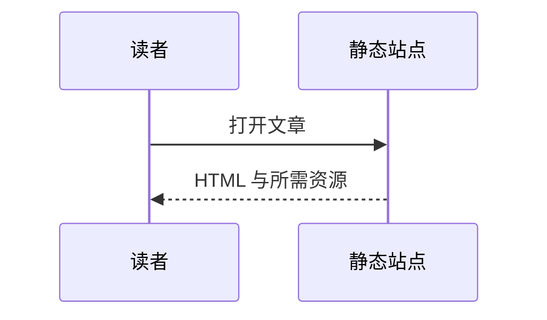

这是一篇可删除的主题功能示例，不代表站长的经历。下面的界面截图来自 Nekomi 项目，视频来自外部平台，仅在点击后加载。

## 提示与说明 {#callouts}

:::note[普通提示]
正文继续使用 **Markdown**，可以写列表、[站内链接](/posts/markdown-guide/) 和 `inline code`。

- 第一项说明。
- 第二项说明。
:::

:::info[补充信息]{icon="info--outlined"}
提示块不会改变普通段落的写作方式。
:::

:::success[完成]
这里适合说明操作成功后的结果。
:::

:::warning[操作前确认]
修改配置前保留自己的文章与资源。
:::

:::danger[注意权限]
不要把服务端密钥写进公开的静态配置。
:::

## 折叠与嵌套 {#details}

::::details[展开补充说明]

这里的内容在没有 JavaScript 时也可以展开。

:::note[折叠中的提示]
支持引用、代码及普通 Markdown。
:::

```js
const mode = 'static';
console.log(mode);
```

### 折叠中的标题 {#inside-details}

目录链接会展开此处，再定位到标题。

::::

## 图片与图片组 {#pictures}


:::gallery[页面截图组]


:::

带有普通链接的图片继续打开链接，不进入灯箱：

[](/posts/markdown-guide/)

## 数学公式 {#math}

行内公式 $E = mc^2$ 和中文可以自然混排。下面是块级公式：

$$
\int_0^1 x^2\,dx = \frac{1}{3}
$$

较长的公式可以在小屏幕上横向滚动：

$$
\mathbf{A}=\begin{bmatrix}a_{11}&a_{12}&a_{13}&a_{14}&a_{15}&a_{16}\\a_{21}&a_{22}&a_{23}&a_{24}&a_{25}&a_{26}\end{bmatrix}
$$

## 图表 {#diagrams}




## 链接卡片 {#links}

::link[Astro 文档]{href="https://docs.astro.build/zh-cn/" description="静态页面、内容集合与图片处理的官方说明。"}

::link[Markdown 排版入门]{href="/posts/markdown-guide/" description="本站的基础写作示例。"}

## 外部视频 {#videos}

::video[YouTube 官方播放器示例]{provider="youtube" id="M7lc1UVf-VE"}

::video[Bilibili 播放器示例]{provider="bilibili" id="BV1GJ411x7h7"}

## 内容 Tabs {#content-tabs-example}

::::tabs[命令行安装方式]
:::tab[npm]

### npm 步骤 {#npm-steps}

```sh
npm install
npm run build
```

:::
:::tab[pnpm]

### pnpm 步骤 {#pnpm-steps}

```sh
pnpm install
pnpm build
```

这里可以继续写段落、列表或提示块。关闭 JavaScript 后，每个选项的内容会按顺序显示。

:::
::::

## 普通内容保持不变 {#plain-markdown}

> 引用、**强调**、列表、表格与链接仍按标准 Markdown 渲染。

| 内容 | 用途 |
| --- | --- |
| 原生 Markdown | 日常写作 |
| 扩展组件 | 有结构的补充内容 |

完整语法、限制与配置见仓库的 Markdown 组件文档。
